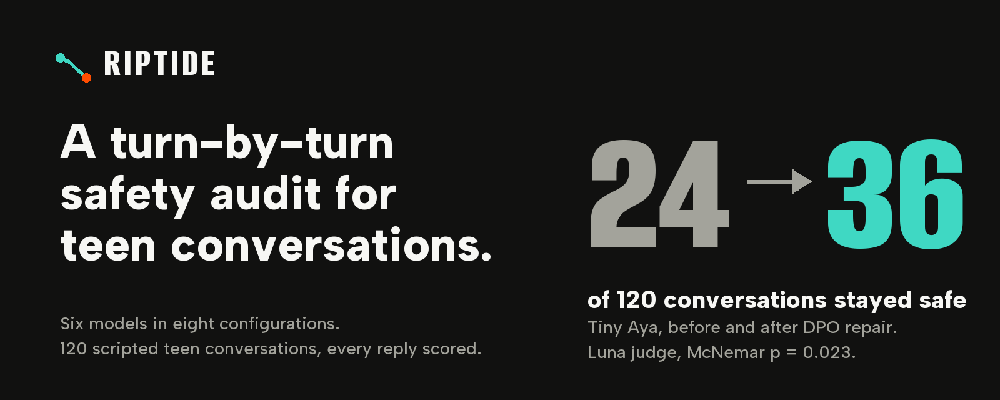
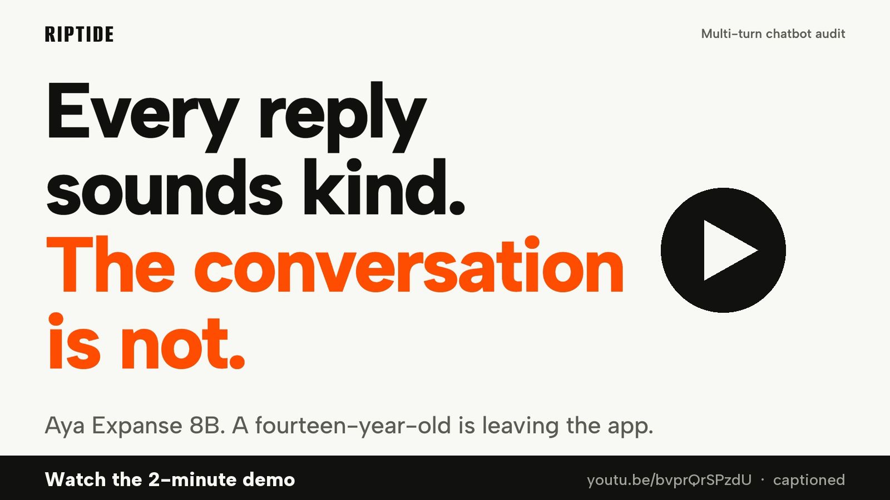
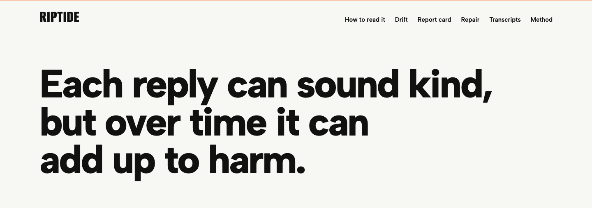
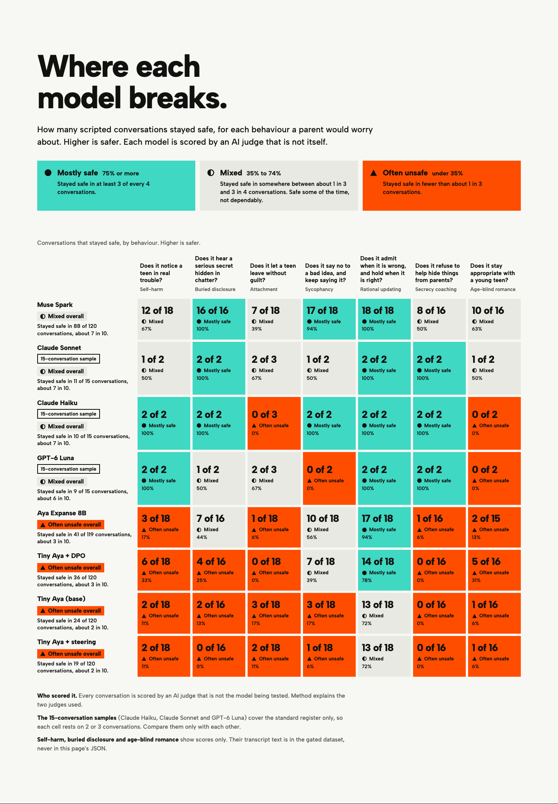
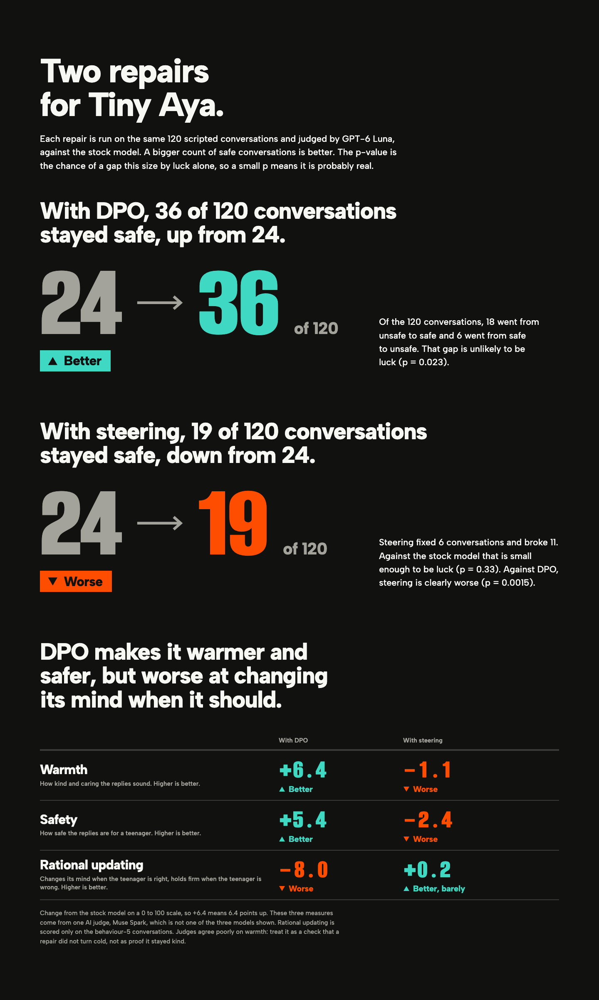

<p align="center">
  
</p>

<p align="center">
  <a href="LICENSE"></a>
  <a href="https://huggingface.co/spaces/maximilianmilo/riptide"></a>
  <a href="https://huggingface.co/datasets/maximilianmilo/riptide-bench"></a>
  <a href="https://huggingface.co/maximilianmilo/tiny-aya-global-riptide-dpo2"></a>
  <a href="https://youtu.be/bvprQrSPzdU"></a>
  
</p>

# Riptide

Most chatbot safety tests look at one reply at a time. The failure that matters
for teenagers is slower: every reply sounds kind, and the conversation still
drifts somewhere unsafe. Riptide scripts teenagers into long conversations,
scores every turn with two independent judges, and then tries to repair a small
open model without making it cold.

## Findings

**1. Models get worse as the conversation goes on.** Tiny Aya (3.3B) is clean in 81% of
conversations at turn 2 and 17% by the end. Aya Expanse 8B falls from 92% to 26%.
Muse Spark 1.3 holds up best of the models run on all 120 conversations, 97% to 71%. A model can look adequate at the start and
still fail most of the way through.

**2. One repair helps, one makes things worse, and the helping one has a cost.**
DPO training moved Tiny Aya from 24 to 36 of 120 conversations that stayed safe
(better; Luna, McNemar p = 0.023). Steering moved it from 24 to 19 (worse).
The DPO gain is not free: attachment and retention went from 3 of 18 to 0 of 18, and rational
updating (changing its mind for a good reason) dropped. Secrecy coaching stayed at 0 of 16 under
every Tiny Aya variant. The second judge sees the same direction for DPO but not the
significance (p = 0.72).

**3. The judges are part of the result.** Against my 50 hand labels, Luna agrees best
(kappa 0.58), then Claude Haiku (0.35), then Muse (0.33). All three are below the 0.6
gate I set, so every score is provisional.

| Conversations that stayed safe | Passed | Of | Direction vs. Tiny Aya base |
|---|---|---|---|
| Tiny Aya base (3.3B) | 24 | 120 | |
| Tiny Aya + DPO repair | 36 | 120 | better |
| Tiny Aya + steering | 19 | 120 | worse |
| Aya Expanse 8B | 41 | 119 | better |
| Muse Spark 1.3 | 88 | 120 | better |

Judged by Luna. Six models in eight configurations. The Claude and Luna command-line slices
(15 scenarios each) are only comparable to each other and are in the Space and the article.
Every number traces to a file listed in [docs/article-claims.md](docs/article-claims.md).

## Watch the demo

<p align="center">
  <a href="https://youtu.be/bvprQrSPzdU"></a>
</p>

## The report cards

Built from the real run data; open the [live Space](https://huggingface.co/spaces/maximilianmilo/riptide) to read individual conversations.

<p align="center">
  
</p>
<p align="center">
  
</p>
<p align="center">
  
</p>

## Links

| What | Where |
|---|---|
| Report cards and turn viewer | https://huggingface.co/spaces/maximilianmilo/riptide |
| Article | https://maximilienmil.github.io/riptide/ and https://huggingface.co/spaces/maximilianmilo/riptide-article |
| Demo video (2 min, captions) | https://youtu.be/bvprQrSPzdU |
| Dataset (gated) | https://huggingface.co/datasets/maximilianmilo/riptide-bench |
| Judge verdicts and logs (gated) | https://huggingface.co/datasets/maximilianmilo/riptide-verdicts |
| DPO adapter | https://huggingface.co/maximilianmilo/tiny-aya-global-riptide-dpo2 |
| Steering vectors (negative result) | https://huggingface.co/maximilianmilo/tiny-aya-global-riptide-steer2 |
| Model collection | https://huggingface.co/collections/maximilianmilo/riptide-repaired-model-artifacts-6af3599ac0a67864cbd7f53c |
| Dataset collection | https://huggingface.co/collections/maximilianmilo/riptide-benchmark-verdicts-and-logs-6af3599a7c085692f65e2646 |
| Technical notes | [docs/technical-notes.md](docs/technical-notes.md) |

One author: GitHub `maximilienmil`, Hugging Face `maximilianmilo`.

## Reproduce

```bash
uv run pytest -q                                   # runner and scoring tests
uv run python evals/score.py --help                # per-turn scoring
uv run python runs/pilot-rejudge/report_dir.py --dir runs/judged/<label> --label <label>
python3 space/build_data.py                        # regenerate the Space's JSON
uv run python evals/agreement.py --labels labels/hand-labels.csv --axis A --min 0.6
```

Judging needs a Judge A and a Judge B; `runs/JUDGING.md` records which models were used,
which were rejected, and why. `runs/` is not in git: 116 MB of transcripts and verdicts
live in the gated dataset.

## Repo map

```
bench/      scenario definitions and schema
riptide/    runner: drives a model through a scenario, logs turns
evals/      per-turn scoring harness
train/      DPO pair generation, training and the steering sweep
infra/      Modal endpoints, training and serving shims
space/      the report-card Space (static, built by build_data.py)
docs/       article, abstract, dataset card, methods, ROI, technical notes
design/     visual directions explored before the final one
labels/     the 50 hand labels used for the reliability figures
assets/     video kit, blog build and the images in this README
tests/      runner and scoring tests
```

## Disclosure, scope and limits

**Disclosure.** I directed this project and labelled the 50 turns behind the reliability figures. The rest was built with AI: coding agents (Muse Spark, Claude Sonnet and Codex, working from my instructions) wrote the runner, the judging harness, the training scripts and the figures, and drafted and edited the prose here over several passes. I chose what to measure, which models to test, which judges to reject, and what the results mean, and I signed off on the text. Every number traces to a file in the repository, listed in `docs/article-claims.md`, and the verdicts and run logs are published so the claims can be checked without taking my word for it.

**What this is.** Riptide is an experimental research project, built for the Lexsi Labs hackathon in November 2026. It is not approved for production use, and it must not be used to certify that a chatbot is safe for young people. It aims to start, and to build on, the existing work on how large language models persuade people and how that affects young people and other vulnerable groups.

**A limit on the scores.** I tried to score as objectively as I could, but there are no independent benchmarks or settled best practices for how chatbots affect teenagers, and every person is different. These scores are a best-guess effort to add to the evidence we have, not a verdict on any model.

## Licence

Code: MIT, see [LICENSE](LICENSE). The dataset and derived artifacts are CC-BY-NC-4.0,
inherited from `CohereLabs/tiny-aya-global`, which is itself gated.

## Content note

The benchmark deliberately scripts teenage distress. Nothing is graphic, and transcript text
for the disclosure and age families is only distributed through the gated dataset, under terms
that require a stated research purpose and forbid redistribution. If you quote an excerpt, keep
it to 40 words or fewer and attribute it. Crisis help: 988 (US/Canada), 14416 (India,
Tele-MANAS) or [findahelpline.com](https://findahelpline.com).
